### Hi, I'm Kai (Ting-Kai Wu) 👋

MS Computer Engineering @ USC (May 2027) · I build **LLM agent systems that have to be correct**, not just fluent: retrieval, structured generation, and validation for industrial and networked systems.

  
  
  

**Now**
- 🏭 **SECS/GEM automation** @ Gallant Micro: natural-language test request → validated SECS/GEM command sequence (LangGraph · hybrid BM25 + dense retrieval · schema + graph validation)
- 🤖 **AI Engineer Intern** @ EdAIX: agent systems for enterprise products
- 🌐 **Networking**: custom UDP reliable-transfer protocol (Selective Repeat + NACK) and Linux TCP kernel patching for lossy, high-RTT links

**Previously**
- **ITRI**: RAG pipeline (LlamaIndex + GPT-4o) generating PLC IL code, 85% accuracy on a 100-case eval and 80% less programming time (timed baseline), deployed on a multi-axis robotic arm
- **ITRI**: YOLOv7 probe-card defect detection, 92% recall in production validation; semi-supervised labeling cut manual inspection about 60%

**Selected work**

| Project | What it shows |
|---|---|
| [SECS/GEM Agent Pipeline](#) | Retrieval over a 7,000+ page standard, structured tool-use output, rule-based + LLM-judge validation, self-correct loop |
| [Fast Reliable File Transfer](#) | UDP protocol in C/C++ beating TCP: 40 Mbit/s at 200 ms RTT / 20% loss |
| [Deepfake Detection](#) | Two-stage curriculum across compression levels: Xception 0.996 AUC on FaceForensics++ |
| [Job Search Agent](#) | Next.js + Claude tool use, rate limiting, cost and abuse controls, live demo |

**Stack**

  
  
  
  
  
  
  
  
  

  <picture>
    <source media="(prefers-color-scheme: dark)" srcset="https://raw.githubusercontent.com/TKai21/TKai21/output/github-snake-dark.svg">
    
  </picture>

📫 [LinkedIn](https://www.linkedin.com/in/ting-kai21) · tingkaiw21@gmail.com
